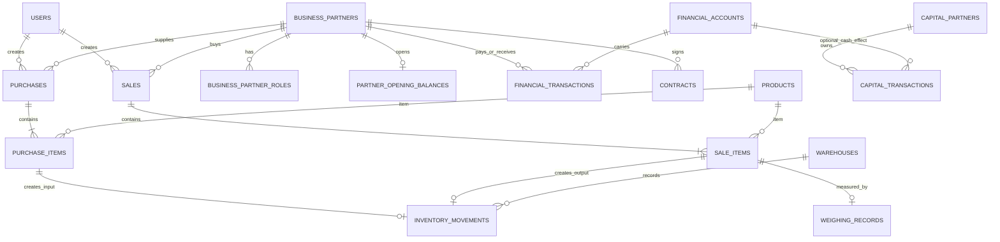

# Database Design

## Implemented tables

### users

- Primary key: `id`.
- Important fields: `name`, unique `email`, hashed `password`, indexed `role`, indexed `is_active`, remember token, timestamps.
- Role values are constrained by the application enum.

### products

- Primary key: `id`.
- Important fields: unique `name`, unique `code`, `unit` (currently `kg`), optional `notes`, indexed `is_active`, timestamps, soft-delete timestamp.
- Product names are seed data, not business-logic constants.

### warehouses

- Primary key: `id`.
- Important fields: unique `name`, optional `location`, optional `description`, indexed `is_active`, timestamps, soft-delete timestamp.
- There is deliberately no editable stock column.

### business_partners

- Primary key: `id`.
- Important fields: indexed `name`, indexed optional `phone`, optional `address`, optional `notes`, indexed `is_active`, timestamps, soft-delete timestamp.
- Customers and suppliers are not split into separate master tables.

### business_partner_roles

- Primary key: `id`.
- Foreign key: `business_partner_id` references `business_partners.id`.
- Important field: indexed `role` with current values `CUSTOMER` and `SUPPLIER`.
- Unique constraint: `business_partner_id` plus `role`.
- Role rows cascade only with deletion of the owning partner record; normal application deletion of a partner is soft deletion.

### Framework support tables

- `password_reset_tokens`, `sessions`, `cache`, `cache_locks`, `jobs`, `job_batches`, and `failed_jobs` are supplied by Laravel.

### purchases and purchase_items

- `purchases` stores the supplier partner, business date, optional external reference, optional managed private `ticket_image_path`, currency, status, notes, creator/confirmer, confirmation timestamp, and timestamps.
- `purchase_items` stores product, destination warehouse, `DECIMAL(18,3)` kilograms, `DECIMAL(18,4)` rate per metric ton, and server-calculated `DECIMAL(18,2)` amount.
- One purchase contains one or more items. Product names are never used as transaction logic keys.

### sales and sale_items

- `sales` stores the customer partner, business date, optional reference, currency, status, notes, creator/confirmer, confirmation timestamp, and timestamps.
- `sale_items` stores product, source warehouse, optional `DECIMAL(18,3)` requested kilograms, nullable `DECIMAL(18,3)` final kilograms, rate per metric ton, and server-calculated amount.
- Requested kilograms remain approximate order context. Final kilograms are populated only by finalized weighing and are authoritative for amount and inventory deduction.

### weighing_records

- Each record belongs to exactly one sale item; a unique `sale_item_id` constraint enforces one weighing per item.
- `weighing_mode` is indexed and stores `DIRECT_NET` or `TWO_STAGE` explicitly. Existing records default safely to `TWO_STAGE` during migration.
- Auditable fields include optional ticket number and station, weighing timestamp, nullable `DECIMAL(18,3)` first/second weights, nullable net weight, optional vehicle/driver snapshots, optional private ticket path, notes, status, creator, finalizer, finalization timestamp, and timestamps.
- `DIRECT_NET` requires a positive net value to finalize and keeps first/second null. `TWO_STAGE` may keep second/net null while draft; finalization rejects a missing or invalid second weight, calculates net server-side, and writes final quantity/amount atomically.
- Current status values are `DRAFT` and `FINALIZED`.
- The sale-item foreign key cascades on deletion only while the parent draft is still eligible for deletion. Application rules prevent item replacement or sale deletion after any weighing exists.
- Creator deletion is restricted; a deleted finalizer is set null without deleting historical weighing evidence.
- Bill binary content is never stored in MySQL. Only a managed path on Laravel's private local disk is persisted; application responses never disclose that path.
- Finalization locks the sale, sale item, and weighing row, then updates status, net-backed final quantity, and decimal-safe amount in one transaction.

### inventory_movements

- Important fields: warehouse, product, movement type, positive `DECIMAL(18,3)` quantity, occurrence timestamp, optional notes, timestamps, and exactly one application-managed source link.
- Current movement types are `PURCHASE_IN` and `SALE_OUT`.
- Direction is derived from movement type: purchase input adds and sale output subtracts.
- Each purchase item and sale item may have at most one movement through unique source foreign keys.
- Source foreign keys use restricted deletion. This prevents a confirmed item from being cascade-deleted beneath its inventory history.
- A movement links to either `purchase_item_id` or `sale_item_id`; the item links to its header, partner, product, warehouse, amount, and business date.
- Warehouse/product stock is calculated from this ledger. No balance cache or editable current-stock column exists.
- Warehouse rows are locked during sale confirmation to serialize stock-spending operations for the same warehouse.

### financial_accounts

- Stores a unique name, account type, one native currency, non-negative `DECIMAL(18,2)` opening balance, opening date, optional description, active status, creator, and timestamps.
- Current balance is not stored. It is derived from the opening baseline and confirmed native-currency financial transactions.
- Account type values are `CASH`, `EXCHANGE`, `BANK`, and `OTHER`; currencies are `USD` and `AFN`.
- Deletion is restricted when any financial transaction references the account. The opening baseline and currency cannot change after confirmed activity exists.

### partner_opening_balances

- At most one opening row belongs to each business partner through a unique foreign key.
- Stores effective date, explicit `RECEIVABLE` or `PAYABLE` type, positive `DECIMAL(18,2)` USD amount, optional notes, creator, and timestamps.
- `RECEIVABLE` yields a positive ledger effect and `PAYABLE` yields a negative effect. No signed amount is entered by the user.
- Partner deletion is restricted while financial history or an opening balance exists.

### financial_transactions

- Represents actual account movement with current types `PAYMENT_RECEIVED`, `PAYMENT_PAID`, and `EXPENSE`.
- Stores account, optional partner, effective transaction date, positive native `DECIMAL(18,2)` amount, currency, optional `DECIMAL(18,6)` AFN-per-USD rate, server-derived `DECIMAL(18,2)` USD equivalent, optional expense category/payee/reference/description, status, creator, confirmer, confirmation timestamp, and timestamps.
- Partner is required for receipt/payment and absent for ordinary expense. Expense category is required only for expense.
- Current status values are `DRAFT` and `CONFIRMED`. Confirmation locks the relevant rows and atomically recalculates USD equivalence and records confirmation audit fields.
- Account and partner foreign keys restrict deletion so historical finance cannot disappear with master records. A deleted confirmer becomes null while the confirmation timestamp remains.
- There are deliberately no current-balance, receivables, payables, duplicated partner-ledger, or manually editable daily-journal tables.

### capital_partners

- Stores a unique owner/partner name, optional phone and notes, active status, and timestamps.
- It is intentionally separate from `users` and `business_partners`: ownership does not grant login access and does not imply a customer/supplier relationship.

### capital_transactions

- Belongs to one capital partner and optionally one USD financial account. Cash types (`INITIAL_CAPITAL`, `CONTRIBUTION`, `WITHDRAWAL`) require the account; non-cash types prohibit it.
- Stores Gregorian business date, controlled type, optional explicit adjustment direction, positive `DECIMAL(18,2)` USD amount, notes, draft/confirmed status, creator/confirmer, and confirmation timestamp.
- Only confirmed rows affect derived capital. Confirmed cash rows are incorporated directly into the linked account balance and daily journal; no duplicate `financial_transactions` row is created.
- Foreign keys restrict deletion of partners/accounts/users that would erase history. Confirmed records are immutable in application services.

### contracts

- Belongs to one `business_partner` and stores unique contract number, controlled purchase/sale/general type, Gregorian start/end dates, optional agreed `DECIMAL(18,2)` amount/currency, required terms, controlled status, creator, and timestamps.
- Contracts are standalone records. There is no foreign key from purchases or sales, so existing trade workflows never depend on them.

## Derived finance views

- Partner statement merges the opening row, confirmed trade headers/items, and confirmed partner payments in business-date order, then applies decimal-safe running effects.
- Financial-account balance applies the transaction-type direction to confirmed native amounts only.
- Receivables and payables filter the derived signed partner balances; payable display uses the absolute value.
- Daily journal derives opening, daily totals, running entries, and closing for a selected native-currency account and date.
- Capital statement derives increases, decreases, and running owner balance from confirmed capital transactions.
- The financial-account summary and daily journal include confirmed linked capital cash movements exactly once.

## Inventory valuation and profit/loss

- No valuation balance or profit table is stored. `InventoryValuationService` reads source-linked movements in business-date order.
- Each warehouse/product stream retains quantity and acquisition value at high BCMath precision. A purchase adds quantity and its server-calculated purchase-item amount.
- Before each sale, moving average cost is `current stream value / current stream kilograms`. COGS is that average multiplied by the sale's finalized movement kilograms.
- Per-sale COGS is rounded half-up to cents; inventory value retains higher working precision and is rounded only for display/report output.
- A period report processes earlier movements to establish opening cost, but includes revenue and COGS only for sales inside the period.
- Missing source/cost evidence marks the report incomplete. The system does not invent zero-cost inventory.

## Simplified relationship diagram

## Final constraints and extension boundaries

- All additional money and rate fields must continue using `DECIMAL`, never binary floating-point columns.
- Future transfer and adjustment types will use the same positive-quantity plus explicit-direction convention.
- Additional financial journals and reports must continue deriving from transaction tables rather than editable report rows.
- Financial history must not be cascade-deleted with master records.
- Business-event dates will use separate date fields where their meanings differ.

## V3 Phase 2 Deal additions

- `deals` stores a stable `DL-######` reference, business and optional requested-delivery dates, optional requested kilograms, one nullable draft Product, four-state lifecycle, notes, creator, and completion audit fields.
- `deal_sources` stores normalized supplier Party, kilograms, purchase rate per ton, server-calculated amount, USD currency, optional external reference, and notes. Many rows per Deal are permitted.
- `deal_destinations` stores normalized customer Party, requested/final kilograms, sale rate per ton, server-calculated amount, USD currency, optional external reference, and notes. Many rows per Deal are permitted.
- `weighing_records.sale_item_id` is nullable and a nullable unique `deal_destination_id` was added. Exactly one association is supplied by application services for new records; legacy Sale weighings remain valid.
- `business_partner_roles` continues to enforce one row per Party/role. The controlled values now include `CUSTOMER`, `SUPPLIER`, `SARAF`, and `PARTNER`; any literal legacy `BOTH` row is expanded safely.
- No Deal foreign key references a warehouse or inventory movement. Direct Deal completion creates no storage event.

## V3 Phase 3 money additions

- `money_movements` is the sole authority for new receipts/payments. It references one optional commercial counterparty, one optional Saraf Party, one optional Deal, and one optional internal financial account.
- Exactly one of `saraf_id` and `financial_account_id` is required by the domain service. Saraf and counterparty must be different active Parties, and role compatibility is checked before confirmation.
- Native `amount` uses `DECIMAL(18,2)`, currency uses USD/AFN, `exchange_rate_to_usd` uses `DECIMAL(18,6)`, and `amount_usd` preserves the audited converted result.
- `DRAFT` and `CONFIRMED` plus creator/confirmer timestamps provide the current lifecycle. Confirmed rows cannot be edited or deleted by application services.
- Party, Saraf, internal-account, Deal, and journal balances remain derived. No running-balance or journal-copy column/table was added.
- Foreign keys use restricted deletion for commercial and money masters; user audit references become null only if an account is removed.

## V3 Phase 4 settlement and storage additions

- `deal_sources.source_type` is `SUPPLIER` or `STORAGE`; `supplier_id` and `warehouse_id` are mutually exclusive in validated commands. `deal_destinations.destination_type` similarly distinguishes `CUSTOMER` and `STORAGE`.
- `deal_allocations` uniquely connects one source/destination pair in the same Deal and stores positive `DECIMAL(18,3)` kilograms, `DECIMAL(18,2)` allocated source cost, explicit automatic/manual method, and creator.
- `deal_quantity_adjustments` stores explicit shortage/excess type, positive kilograms, nullable calculated USD cost, required reason, draft/confirmed state, and confirmation audit.
- `deal_expenses` stores category, business date, native amount/currency, explicit AFN-per-USD rate when needed, audited USD amount, optional payee, optional unique confirmed expense-payment link, reference/notes, and draft/confirmed audit fields.
- `deal_settlements` stores a unique revision per Deal and immutable confirmed snapshot totals for quantities, source value, revenue, expenses, shortage cost, final result before partnership, JSON provenance, and preparer/confirmer metadata.
- `inventory_movements` now permits one unique `deal_source_id` or `deal_destination_id` and an optional cost amount. Phase 4 uses `DEAL_STORAGE_IN` and `DEAL_STORAGE_OUT`; no stock or storage-claim balance column is introduced.
- Storage claim, current stock, weighted cost, Deal result, and report totals remain derived projections.
