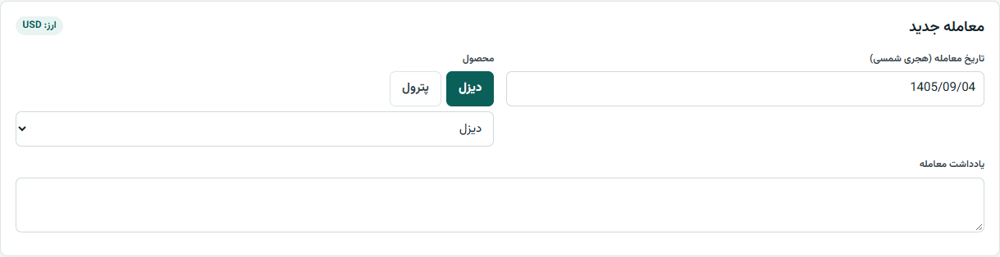
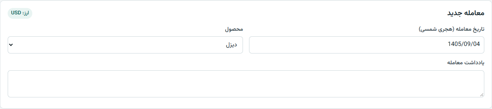
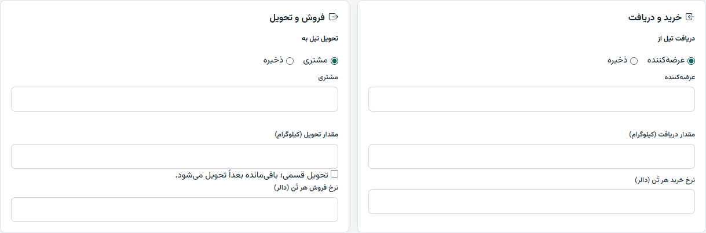
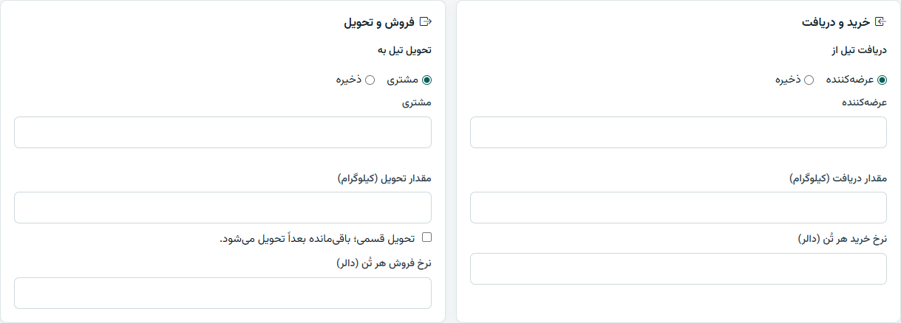
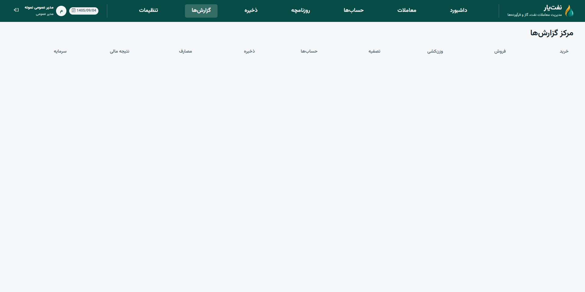
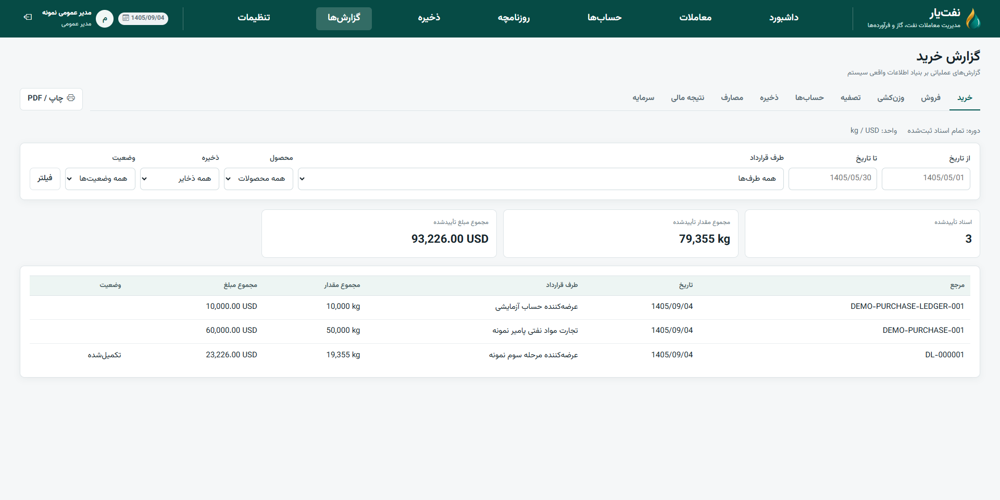

# بازبینی دوم مالک نفت‌یار

این تصویرها از اجرای واقعی نفت‌یار در Microsoft Edge 158.0.4370.33 گرفته شده‌اند. ستون «پیش» نسخهٔ `751f875` و ستون «پس» تغییرات این درخواست را نشان می‌دهد. هر دو نسخه با کاپی یکسان از دیتابیس آزمایشی و معلومات ساختگی اجرا شدند. بزرگ‌نمایی مرورگر ۱۰۰٪ بود. اندازهٔ نمای دسکتاپ ۱۹۲۰ × ۹۶۰ و نمای موبایل در Edge ویندوز ۳۹۰ × ۸۴۴ پیکسل بود.

## دسکتاپ

| بخش | پیش | پس |
| --- | --- | --- |
| انتخاب محصول |  |  |
| نام عرضه‌کننده و گزینهٔ تحویل قسمی |  |  |
| نتیجۀ کلیک مدیر عمومی بر «گزارش‌ها» |  |  |
| گزارش مصارف و دکمهٔ چاپ | [پیش](before/desktop-report-toolbar.png) | [پس](after/desktop-report-toolbar.png) |
| توضیح معاملهٔ تکمیل‌شده | [پیش](before/desktop-status.png) | [پس](after/desktop-status.png) |

## موبایل

تصویرهای فورم از بخش مربوطه گرفته شده‌اند. تصویرهای گزارش، نمای کامل صفحه را نشان می‌دهند.

| بخش | پیش | پس |
| --- | --- | --- |
| انتخاب محصول | [پیش](before/mobile-product.png) | [پس](after/mobile-product.png) |
| نام عرضه‌کننده | [پیش](before/mobile-supplier.png) | [پس](after/mobile-supplier.png) |
| گزینهٔ تحویل قسمی | [پیش](before/mobile-spacing.png) | [پس](after/mobile-spacing.png) |
| توضیح معاملهٔ تکمیل‌شده | [پیش](before/mobile-status.png) | [پس](after/mobile-status.png) |
| گزارش پیش‌فرض مدیر عمومی | [پیش](before/mobile-reports.png) | [پس](after/mobile-reports.png) |
| گزارش مصارف و دکمهٔ چاپ | [پیش](before/mobile-report-toolbar.png) | [پس](after/mobile-report-toolbar.png) |

در بازبینی نوشته‌ها، ۲۳ صفحه در هر دو اندازهٔ نمایش بررسی شد. برچسب‌های فورم، نقش‌ها، وضعیت اسناد، صورت‌حساب‌ها و فیلترهای گزارش نیز در اندازهٔ اصلی دیده شدند.

## نتیجهٔ بررسی

- در هر دو نسخه دیزل محصول پیش‌فرض این نمونه بود. در نسخهٔ جدید دیزل، پترول و گاز مایع از همان فهرست انتخاب شدند. در Edge یک معاملهٔ گاز مایع با موفقیت ثبت شد و شناسهٔ محصول معاملهٔ قبلی دیزل حفظ شد.
- برچسب «عرضه‌کننده» با همان نیم‌فاصله و قلم محلی وزیرمتن از ۱۲ به ۱۴ پیکسل تغییر کرد. فاصلهٔ تعیین‌شده میان مربع تحویل قسمی و متن آن ۹٫۶ پیکسل است. کلیک روی متن، علامت مربع را تغییر می‌دهد.
- مدیر عمومی، مدیر سیستم، حسابدار، مسئول خرید و فروش و مسئول ذخیره از منوی اصلی و نشانک `/reports` به گزارش خرید رسیدند. مسئول حمل‌ونقل از هر دو مسیر به گزارش وزن‌کشی رسید. هر شش نقش در Edge به گزارش‌های مجاز خود دسترسی داشتند. آزمون‌های سمت سرور پاسخ ۴۰۳ برای گزارش‌های محدود را نیز بررسی کردند.
- در گزارش مصارف، «چاپ / PDF» از دو سطر به یک سطر رسید. فیلتر محصول و تولید PDF بررسی شدند. شمار ردیف‌های پنج گزارش دارای معلومات، در حالت نمایش و چاپ برابر بود.
- آزمون کامل MySQL با ۴۰۱ آزمون و ۳٬۰۵۲ بررسی موفق بود. در SQLite تعداد ۳۹۶ آزمون و ۳٬۰۱۱ بررسی موفق بود؛ پنج آزمون اختصاصی MySQL در همان MySQL اجرا شدند. هر ۱۴ آزمون JavaScript و ساخت نهایی فایل‌های وب موفق بودند.

در هر دو نسخه و با نام نسبتاً طولانی کاربر آزمایشی، بخش خروج از حساب در سربرگ موبایل حدود ۷ پیکسل از عرض نمایش بیرون می‌رفت. این مورد در تصویرهای مقایسه ثبت شده است و مربوط به سربرگ قبلی است.
